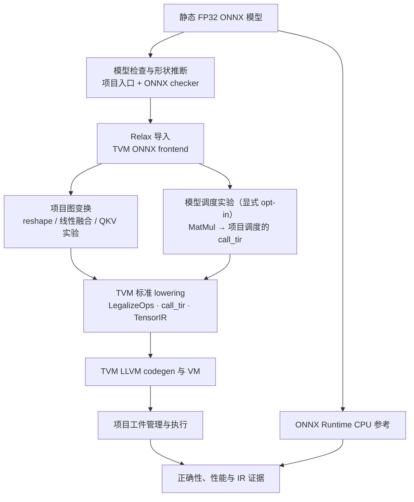

# MiniTensorCompiler 架构与职责

项目围绕固定版本 Apache TVM 0.27.0.post1 提供 ONNX 模型的 CPU 编译实验：模型检查、受保护的图变换、TensorIR 调度、正确性比较和可复现实验。参考目标为 Linux x86_64、Python 3.11、LLVM CPU；已有运行证据以具体报告中的机器为准。静态 FP32 是目前的主要范围，动态形状、CUDA、跨机器原生工件兼容性不作端到端支持声明。

上图的 Pass 和调度是不同的可选实验入口，不代表每次运行都会依次启用所有优化。尤其 `scheduled` 先做 reshape，再对符合条件的原始 Relax MatMul 注入调度；`custom` 使用线性融合及插入 `FuseTIR` 的流水线。这两条路径不合并使用。QKV 合并默认关闭，仅在代码接口中由调用者显式允许具体形状；不等同于自动成本模型。

## 数据流与模块

1. `models/` 使用 PyTorch 生成固定种子、静态形状的 MLP、CNN、QKV ONNX；这些模型只覆盖项目的工作负载，不是完整 ONNX 算子兼容性声明。
2. `minicompiler/frontend/onnx_loader.py` 调用 ONNX checker、shape inference 和 TVM frontend，生成摘要；运行时输入要求静态正维 FP32 tensor（标量无维度），不支持的自定义 domain 和不可接受的输入明确报错。导入时可选择将权重嵌入或保留为输入；工件与 benchmark 路径使用嵌入权重。
3. `minicompiler/ir/` 统计 Relax 调用、形状、dtype 及单算子 DFPattern；未知形状不假定安全。`minicompiler/passes/` 实现语义守卫、改写规则与报告；[Pass 正确性](pass_correctness.md)和[线性融合](linear_fusion.md)记录适用边界。
4. `minicompiler/schedules/matmul_cpu.py` 构造静态 FP32 MatMul 的五级 TIR 调度。`compiler/scheduled_matmul.py` 可在原始 Relax 图上将合规的二维 MatMul 替换为项目调度的 `call_tir`，再交给 TVM 默认编译；非目标形状不改写。[调度说明](schedule_optimization.md)区分独立消融与模型级 opt-in 路径。
5. `minicompiler/compiler/` 负责调用 TVM 编译、导出及读取 VM 工件，并可收集证据。`evidence` 的 `LegalizeOps` 检查 IR 是独立分析，正式编译从 Pass 后模块开始；同一次编译的 VM 文本及可用 LLVM IR/汇编来自实际编译结果。工件与证据导出是两次独立编译，见 [IR 证据链](ir_walkthrough.md)。
6. `minicompiler/runtime/` 检查输入并运行 TVM VM，与 ONNX Runtime CPU 对照。`profiling/` 和 `benchmarks/` 记录固定输入、线程设置、延迟分布、误差及配置。静态 TIR PrimFunc 数与运行时调用次数不同；未测到的指标不以静态数替代。

## 实现归属

| 项目实现 | 使用的现成能力 |
|---|---|
| 工作负载、输入范围检查、IR 摘要及 CLI | PyTorch ONNX 导出、ONNX checker / shape inference、TVM ONNX frontend |
| reshape、线性子图和 QKV 的匹配条件、守卫、报告及实验性改写 | TVM Relax IR、DPL、`FuseOpsByPattern`、`FuseTIR` 等基础设施；TVM 也自带部分相似变换 |
| MatMul 调度策略、模型级接入、消融脚本 | TVM TensorIR/TIRx、Schedule API、标准 lowering |
| 工件校验、VM 调用、误差和性能报告 | TVM LLVM codegen / VM、ONNX Runtime CPU、NumPy |

编译工件包含原生代码，只应加载可信来源。manifest 中的 hash 是误配检测，不是可信签名；系统、架构与 TVM 版本检查也不能证明不同机器或 ABI 兼容。

## 证据与实验口径

TVM Default 是项目图优化的正式对照，NoFusion 是诊断模式；固定版本的 CPU 默认流程本身不执行 `FuseOps`/`FuseTIR`，所以 NoFusion 可能与它相同。自定义路径与 Default 比较时应保持模型、权重、输入、目标及线程一致。ORT 是独立系统，仅用作正确性参考及另一个性能对照。不要把 ORT/TVM 差异、静态 PrimFunc 数或缓存命中归因于项目 Pass。性能测试与环境约束见 [benchmark 方法](benchmark_methodology.md)。
